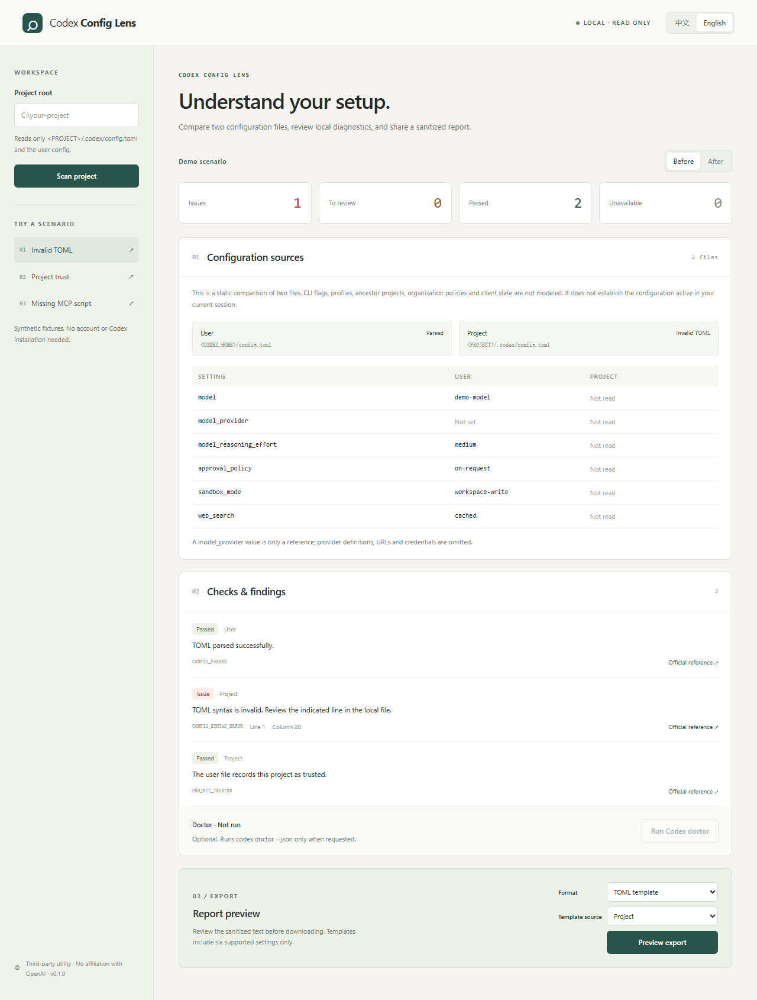
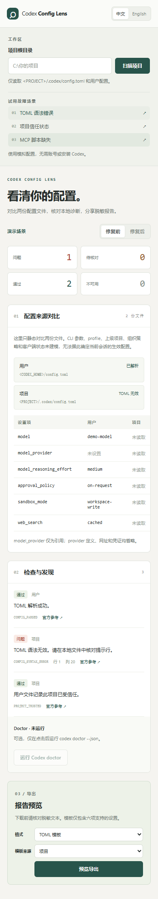

# Codex Config Lens

[简体中文](README.zh-CN.md)

[](https://github.com/ZeyuYan66/codex-config-lens/actions/workflows/ci.yml)

Understand your Codex setup: compare configuration sources, review local checks, and export a sanitized report. A small Windows-first tool with an English / 简体中文 interface, CLI, and companion Codex skill.



## Start in two commands

Get the source from [this repository](https://github.com/ZeyuYan66/codex-config-lens) using **Code → Download ZIP** or `git clone https://github.com/ZeyuYan66/codex-config-lens.git`. Install [Node.js 24 or newer](https://nodejs.org/) with npm, then run these commands **inside the extracted or cloned repository**:

```powershell
npm ci
npm start
```

Open [the local UI](http://127.0.0.1:4178). Try **Invalid TOML → Before / After → English / 中文 → Preview export**. No Codex installation, account, API key, or model API is needed for demos and static scans. Stop the server with Ctrl+C.

After dependencies are installed, `node bin/codex-config-lens.mjs serve` also starts the UI. Use `npm start -- --port 4180` if port 4178 is occupied.

## What it shows

- Six settings from `<CODEX_HOME>/config.toml` and `<PROJECT>/.codex/config.toml`, side by side. `CODEX_HOME` is respected; otherwise the user home `.codex` directory is used.
- Invalid TOML, explicit project trust records, and missing absolute local MCP script references, with evidence and next checks.
- An optional **Run Codex doctor** button. It runs the installed `codex doctor --json` in the selected project only after you click. Missing or unsupported CLI versions leave static scanning available.
- English / Simplified Chinese Markdown reports and minimal TOML templates. Templates select **one source** and include only `model`, `model_provider`, `model_reasoning_effort`, `approval_policy`, `sandbox_mode`, and `web_search`.

**Configuration sources are a static comparison.** CLI flags, profiles, ancestor projects, organization policy, and client state are not modeled. These results cannot establish the active configuration of a current session. Unknown trust and unsupported MCP launch forms remain “Review”. Script existence does not establish that the server works.

Only simple `node <absolute .js/.mjs/.cjs>` and `python|python3 <absolute .py>` commands without extra arguments are checked for existence. MCP commands are never executed. The doctor schema adapter accepts version 1 with an object of checks; only `installation` has a specific interpretation in v0.1. Unknown checks are numbered and marked for review. Compatibility was observed with Codex CLI 0.144.5; it is not a guarantee for all versions.

On Windows, automatic script checks require a fully qualified local drive path; current-drive, UNC and device paths remain “Review”. Doctor resolves a native executable from absolute PATH entries or the Codex desktop install directory, excludes the selected project directory, and launches its absolute path without a shell. `.cmd`/`.bat` shims are unsupported and may produce “Unavailable”. Doctor uses the same selected `CODEX_HOME` as the scan; empty doctor reports are unavailable. Failed source reads display “Not read”, and templates state the selected source's status.

## CLI

```powershell
node bin/codex-config-lens.mjs scan --project "C:\my-project" --format json
node bin/codex-config-lens.mjs export --project "C:\my-project" --format markdown --lang en --source user
node bin/codex-config-lens.mjs export --project "C:\my-project" --format toml --lang zh-CN --source project
```

Output goes to stdout. Scans and exports never edit configuration. `--codex-home <path>` overrides the user directory for synthetic fixtures or a selected installation. CLI exit 0 means the scan produced a report, even when the report contains issues; malformed arguments exit 1 with a fixed reason code. The CLI has no automatic doctor invocation.

Three reproducible, offline scenarios:

| Demo ID | Expected finding before | After |
| --- | --- | --- |
| `syntax-error` | `CONFIG_SYNTAX_ERROR` | Valid TOML |
| `untrusted-project` | `PROJECT_NOT_TRUSTED` | Explicit trusted record |
| `missing-script` | `MCP_SCRIPT_NOT_FOUND` | Simulated file exists |

```powershell
node bin/codex-config-lens.mjs scan --demo syntax-error --variant before --format json
node bin/codex-config-lens.mjs scan --demo missing-script --variant after --format json
node bin/codex-config-lens.mjs export --demo untrusted-project --format markdown --lang en --source user
```

The [examples](examples/) are synthetic snippets. The app demos run real parsing and analysis with simulated file existence; “After” does not modify any file or create a server script.

## Sharing and local boundaries

The browser receives a whitelisted summary, never raw configuration, raw doctor JSON or exception messages. Environment values, credentials, headers, service URLs, MCP arguments and custom provider tables are excluded. Paths become placeholders; MCP names become stable numbers. Suspicious setting strings are hidden; unexpected types and strings over 128 characters are omitted from templates. `model_provider` is only a reference, so additional provider configuration may be needed locally.

This is a whitelist with additional heuristic checks, **not a detector for every possible secret**. Review the export preview before sharing. CLI users should inspect stdout before redirecting it to a file or posting it.

The service binds only to `127.0.0.1`, validates Host/Origin, uses a per-run API credential, and has a static route whitelist. Files are limited to 512 KiB with resolved-path containment; TOML parsing runs in a terminable worker (2 seconds). Doctor has a 30 second / 2 MiB limit. No telemetry, cloud storage, automatic repairs, login, MCP installation, or model API calls. Browser storage keeps only your language choice. Local extensions, local processes and browser compromise are outside this boundary.

## Companion skill

Run the program independently first. Keep the checkout in a stable location with dependencies installed. Copy `skills/codex-config-lens` into your Codex skill directory:

```powershell
$lensSkillRoot = if ($env:CODEX_HOME) { Join-Path $env:CODEX_HOME 'skills' } else { Join-Path $env:USERPROFILE '.codex\skills' }
New-Item -ItemType Directory -Path $lensSkillRoot -Force | Out-Null
Copy-Item -LiteralPath '.\skills\codex-config-lens' -Destination $lensSkillRoot -Recurse
```

If that destination already exists, inspect it before replacing it. Reload skills or restart Codex, then ask:

> Use $codex-config-lens from my checkout at C:\tools\codex-config-lens to compare the configuration sources for C:\my-project and explain the findings in English.

The installed skill is instructions, not a bundled program. It needs the checkout path and project root. It reads only the public CLI summary, responds in your language, distinguishes issues from uncertainty, and exports a report only when requested. It does not read `auth.json` or change settings. [Skill source](skills/codex-config-lens/SKILL.md).

## Development and verification

```powershell
npm run check
npm test
```

Native Node tests cover parsing limits, Windows path comparisons, trust, MCP references, doctor failures/process cleanup, output privacy, CLI, offline demos, and HTTP guards. Windows may skip the real symbolic-link test if link privileges are unavailable; the injected path containment test still runs. CI uses Node 24 on Windows and synthetic inputs without a Codex account.



[Design and scope](docs/superpowers/specs/2026-10-11-codex-config-lens-design.md) · [Release checklist](docs/release-checklist.md) · [v0.1.0 notes](docs/releases/v0.1.0.md)

MIT licensed. Third-party project; not affiliated with or endorsed by OpenAI. Contributions with reproducible, synthetic configuration examples are welcome. Do not submit credentials or raw personal diagnostic output in issues.
