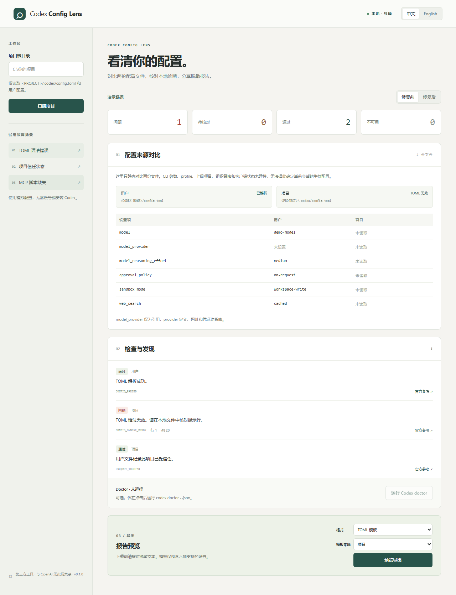
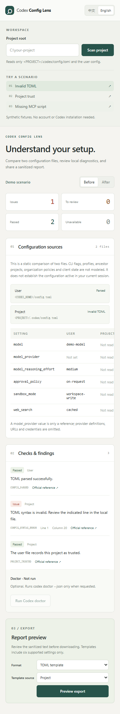

# Codex Config Lens

[English](README.md)

[](https://github.com/ZeyuYan66/codex-config-lens/actions/workflows/ci.yml)

看懂 Codex 的配置来源，核对本地检查，导出脱敏报告。面向 Windows 的小工具，提供中文 / English 界面、CLI 和配套 Codex skill。



## 两条命令启动

在[仓库页面](https://github.com/ZeyuYan66/codex-config-lens)选择 **Code → Download ZIP**，解压后使用；或运行 `git clone https://github.com/ZeyuYan66/codex-config-lens.git`。安装包含 npm 的 [Node.js 24 或更新版本](https://nodejs.org/)，在**解压或克隆后的仓库目录内**运行：

```powershell
npm ci
npm start
```

打开[本地页面](http://127.0.0.1:4178)，试用 **TOML 语法错误 → 修复前 / 修复后 → 中文 / English → 预览导出**。演示和静态扫描无需安装 Codex、登录账号、API key 或模型 API。Ctrl+C 停止服务。

安装依赖后也可用 `node bin/codex-config-lens.mjs serve` 启动。4178 端口被占用时，使用 `npm start -- --port 4180`。

## 能看什么

- 并排显示 `<CODEX_HOME>/config.toml` 和 `<PROJECT>/.codex/config.toml` 中六项设置。用户目录遵循 `CODEX_HOME`，未设置时使用用户主目录的 `.codex`。
- 检查 TOML 语法错误、明确的项目信任记录和绝对路径引用的 MCP 脚本缺失，并给出证据及下一步检查。
- 可选的**运行 Codex doctor** 按钮：仅在点击后，在选定项目中运行已安装的 `codex doctor --json`。CLI 缺失或版本不支持时，静态扫描仍可使用。
- 中英文 Markdown 报告和最小 TOML 模板。模板选择**一个来源**，仅包含 `model`、`model_provider`、`model_reasoning_effort`、`approval_policy`、`sandbox_mode`、`web_search`。

**配置来源对比是静态比较。** CLI 参数、profile、上级项目、组织策略和客户端状态未建模，无法由此确定当前会话的生效配置。未知 trust 和不支持的 MCP 启动形式标为“待核对”。脚本存在不代表服务能够正常运行。

只检查没有额外参数的 `node <绝对路径 .js/.mjs/.cjs>` 和 `python|python3 <绝对路径 .py>`。绝不执行 MCP 命令。Doctor 适配接受 schemaVersion 1 且 checks 为对象的报告；v0.1 只具体解释 `installation`，其他检查用编号标为待核对。已在 Codex CLI 0.144.5 观察到支持结构，不保证兼容所有版本。

Windows 自动脚本检查要求明确的本地盘符绝对路径，当前盘根路径、UNC 和设备路径标为待核对。Doctor 从绝对 PATH 条目或 Codex 桌面安装目录解析原生可执行文件，排除所选项目目录，以绝对路径和无 shell 模式启动。不支持 `.cmd` / `.bat` 包装脚本，可能显示不可用。Doctor 与扫描使用同一选定的 `CODEX_HOME`；空诊断报告标为不可用。读取失败的来源显示“未读取”，模板也注明来源状态。

## CLI

```powershell
node bin/codex-config-lens.mjs scan --project "C:\my-project" --format json
node bin/codex-config-lens.mjs export --project "C:\my-project" --format markdown --lang en --source user
node bin/codex-config-lens.mjs export --project "C:\my-project" --format toml --lang zh-CN --source project
```

结果写入 stdout，扫描和导出都不会修改配置。`--codex-home <路径>` 可选择模拟用户目录或指定安装的配置目录。退出码 0 表示成功生成报告，报告内仍可能有问题；无效参数退出码 1，只输出固定原因代码。CLI 不会自动运行 doctor。

三个可复现的离线场景：

| 演示 ID | 修复前的代码 | 修复后 |
| --- | --- | --- |
| `syntax-error` | `CONFIG_SYNTAX_ERROR` | 有效 TOML |
| `untrusted-project` | `PROJECT_NOT_TRUSTED` | 明确的 trusted 记录 |
| `missing-script` | `MCP_SCRIPT_NOT_FOUND` | 模拟文件存在 |

```powershell
node bin/codex-config-lens.mjs scan --demo syntax-error --variant before --format json
node bin/codex-config-lens.mjs scan --demo missing-script --variant after --format json
node bin/codex-config-lens.mjs export --demo untrusted-project --format markdown --lang en --source user
```

[examples](examples/) 提供模拟片段。页面演示复用真实解析和分析，只模拟脚本存在性；“修复后”不会修改任何文件，也不会创建服务器脚本。

## 分享与本地边界

浏览器只收到白名单摘要，收不到配置原文、doctor 原始 JSON 或异常消息。环境变量值、凭证、请求头、服务地址、MCP 参数和自定义 provider 表被排除。路径使用占位符，MCP 名称使用固定编号。疑似敏感字符串隐藏，异常类型及超过 128 字符的值不写入模板。`model_provider` 仅是引用，可能还需在本地补充 provider 配置。

这是带额外启发式检查的白名单，**无法识别任意秘密**。分享前请核对导出预览；CLI 用户应先检查 stdout，再保存或发布。

服务仅监听 `127.0.0.1`，校验 Host/Origin，使用每次启动的 API 凭证及静态路由白名单。文件限制 512 KiB，检查真实路径是否越界；TOML 使用可终止工作线程，限时 2 秒。Doctor 限时 30 秒、输出最多 2 MiB。没有遥测、云存储、自动修复、登录、安装 MCP 或模型 API 调用。浏览器仅保存语言偏好。本地扩展、本地进程或浏览器被入侵不在此边界内。

## 配套 skill

先独立运行程序，将安装好依赖的仓库保存在固定位置。把 `skills/codex-config-lens` 复制到 Codex 的 skill 目录：

```powershell
$lensSkillRoot = if ($env:CODEX_HOME) { Join-Path $env:CODEX_HOME 'skills' } else { Join-Path $env:USERPROFILE '.codex\skills' }
New-Item -ItemType Directory -Path $lensSkillRoot -Force | Out-Null
Copy-Item -LiteralPath '.\skills\codex-config-lens' -Destination $lensSkillRoot -Recurse
```

目标已存在时，先检查再决定是否替换。重新加载 skill 或重启 Codex，然后输入：

> 使用 $codex-config-lens，程序仓库在 C:\tools\codex-config-lens，比较 C:\my-project 的配置来源，用中文解释结果。

安装的 skill 是说明文件，不含程序本身，需要仓库路径和项目根目录。它只读取 CLI 公开摘要，按用户语言区分问题与不确定性，用户要求时才导出报告；不读取 `auth.json`，不修改设置。[Skill 源文件](skills/codex-config-lens/SKILL.md)。

## 开发与验证

```powershell
npm run check
npm test
```

原生 Node 测试覆盖解析限制、Windows 路径比较、trust、MCP 引用、doctor 失败和进程回收、输出脱敏、CLI、离线演示与 HTTP 边界。Windows 缺少链接权限时，真实符号链接用例会跳过，注入的路径越界检查仍运行。CI 使用 Windows + Node 24 和模拟输入，不需要 Codex 账号。



[设计与范围](docs/superpowers/specs/2026-10-11-codex-config-lens-design.md) · [发布清单](docs/release-checklist.md) · [v0.1.0 说明](docs/releases/v0.1.0.md)

采用 MIT 许可证。第三方项目，与 OpenAI 无隶属关系，未获得其背书。欢迎提供可复现的模拟配置案例；请勿在 issue 中提交凭证或个人原始诊断输出。
